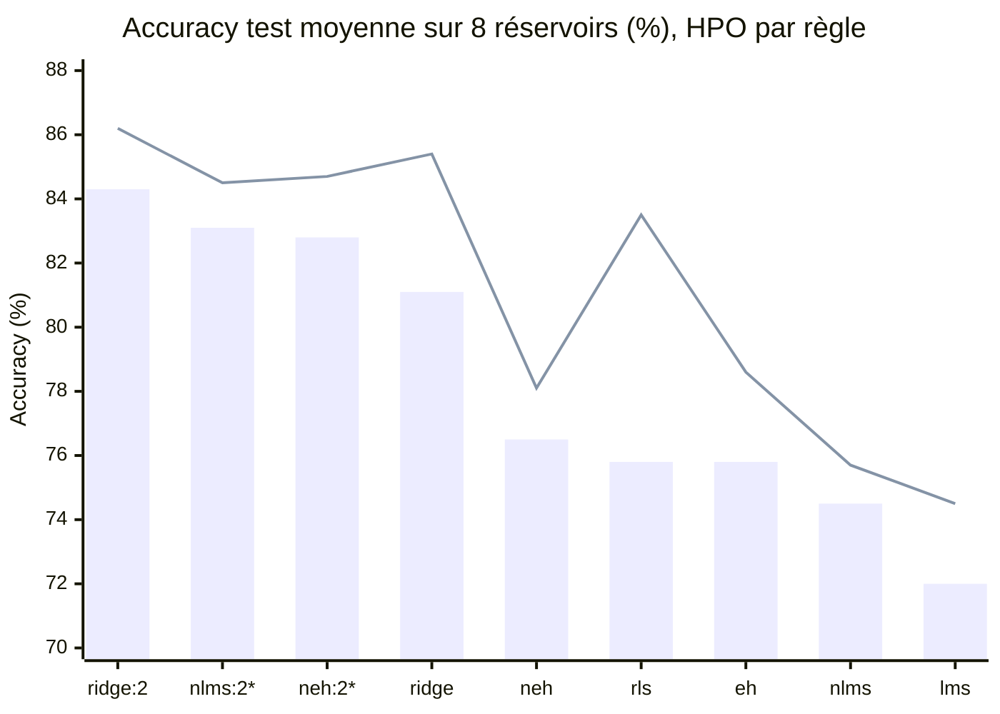

# Le pas NLMS est ancien, ses combinaisons inédites

Sur nos quatre règles, **une seule est clairement publiée : `nlms`**. Un readout d'ESN entraîné par NLMS et comparé à RLS figure dans la thèse de Yuenyong (Tokyo Tech, 2014), et la normalisation φ(x)/(‖φ(x)‖² + ε) est déjà le cœur de la règle BPDC de Steil (2004). **`neh` n'a pas d'équivalent publié**, mais il a un précurseur direct : la règle RMH « décorrélée » de Burms, Caluwaerts & Dambre (2015), qui se réduit à un pas ε-NLMS quand l'essai ne compte qu'un pas de temps. **`nlms:2` assemble des briques toutes connues** (readout quadratique d'Ohkubo & Inubushi 2024, Volterra-NLMS d'ordre 2, filtres adaptatifs à noyau sur ESN comme ES-KRLS). L'assemblage lui-même n'a pas été trouvé, sous réserve d'un article IEEE non lu sur la régression polynomiale en ligne en RC physique. **`neh:2` paraît nouveau** : aucun travail trouvé n'applique EH, ni aucune règle modulée par la récompense, à des monômes, à un noyau ou à des features non linéaires de l'état. La valeur publiable tient donc moins aux règles qu'au **résultat empirique** : sur les monômes d'ordre 2, des règles du premier ordre à pas normalisé arrivent à 1 à 2 points de ridge:2 et dépassent RLS sur l'état brut, à l'inverse de ce que prédit la littérature sur la dispersion des valeurs propres. Ce constat est provisoire, car les HPO de nlms:2 et neh:2 ne sont pas terminées. La recherche reste incomplète : sans accès à Google Scholar ni à Semantic Scholar en recherche plein texte, des actes de conférence peu indexés ont pu échapper aux requêtes.

Convention de vérification utilisée dans tout le rapport. **[lu]** : le texte intégral, ou au moins la section Méthodes, a été lu et les équations vérifiées. **[résumé]** : le point vient seulement d'un résumé, d'une notice, d'un extrait de moteur de recherche ou d'une citation de seconde main. **[code]** : le point vient de l'inspection du code local (canopy, reservoirpy).

## NLMS en readout est publié depuis au moins 2014, et toujours perdant face à RLS

La seule étude académique trouvée qui **nomme NLMS comme readout d'ESN** est la thèse de doctorat de Sumeth Yuenyong, *Reservoir Adaptation and Low Cost Online Readout Training for Echo State Network in Adaptive Filtering* (Tokyo Tech, 2014, dir. A. Nishihara) **[lu]**. Sur NARMA10 avec N = 100, apprentissage en ligne sur 1000 échantillons et 100 essais, elle compare des versions standard de NLMS (μ = 0,5, ε = 0,1), de VLLMS et de RLS. Résultats : **NMSE 0,667 pour NLMS, 0,652 pour VLLMS, 0,281 pour RLS**. L'auteur attribue l'écart à une dispersion des valeurs propres (EVS) de la covariance des états d'environ 10^16, qui « make LMS type algorithms ineffective compared to RLS » ([Yuenyong 2014](https://t2r2.star.titech.ac.jp/rrws/file/CTT100675128/ATD100000413/)). Le même chapitre teste BPDC comme readout (NMSE 0,670) et conclut qu'il n'y a pas d'alternative à RLS. La thèse choisit donc de réduire le coût de RLS (readout ELM), pas d'améliorer les règles du premier ordre.

La normalisation elle-même est encore plus ancienne en RC. La règle **BPDC de Steil (2004)** s'écrit Δw_ij = (η/Δt) · φ(x_j)/(Σ_s φ(x_s)² + ε) · γ_i, avec ε = 0,002 **[lu, via Steil 2005]**. Le facteur φ(x_j)/(‖φ(x)‖² + ε) est exactement le pas d'ε-NLMS ; seul le terme d'erreur γ_i diffère, car il mélange l'erreur courante et une erreur rétropropagée d'un pas. Steil y voit une « décorrélation approximative », pas un NLMS ([Steil, ESANN 2005](https://www.esann.org/sites/default/files/proceedings/legacy/es2005-114.pdf) ; [Steil, IJCNN 2004](https://pub.uni-bielefeld.de/record/2142215)). Hors RC, la forme normalisée W ← W + α ε X/|X|² (α-LMS) est présentée dans la revue de Widrow & Lehr (1990) **[résumé, OCR peu fiable]** ([Widrow & Lehr 1990](https://www-isl.stanford.edu/~widrow/papers/j199030years.pdf)). `nlms` ne peut donc pas être présenté comme une règle nouvelle, ni comme un premier usage en RC.

Le reste de la littérature explique pourquoi NLMS est resté marginal. Les revues canoniques posent le problème en termes d'EVS (« sometimes reaches 10^12 or even higher ») et en concluent qu'il faut passer de LMS à RLS ou à la ridge hors ligne. **NLMS n'y est pas nommé** ([Lukoševičius & Jaeger 2009](https://www.ai.rug.nl/minds/uploads/2261_LukoseviciusJaeger09.pdf) **[lu]** ; [Lukoševičius 2012](https://www.ai.rug.nl/minds/uploads/PracticalESN.pdf) **[lu]**). Les implémentations matérielles qui apprennent en ligne utilisent un **LMS non normalisé**, avec un pas constant ou décroissant. C'est le cas du réservoir opto-électronique sur FPGA d'Antonik et al. **[lu]** ([arXiv:1610.06268](https://arxiv.org/abs/1610.06268)) et de l'accélérateur memristif de Zyarah & Kudithipudi (2024) **[résumé]** ([arXiv:2405.13347](https://arxiv.org/html/2405.13347v2)). Aucune bibliothèque ne propose NLMS. reservoirpy n'a qu'un `LMS` sans normalisation et un `RLS` **[code]**. PyRCN, ReservoirComputing.jl et rclib n'ont pas de NLMS **[résumé]** ([rclib](https://hrshtst.github.io/rclib/theory/readout_algorithms)). Aucun papier n'utilise APA, PNLMS ou sign-NLMS comme readout de réservoir.

Nos chiffres concordent avec cette lecture. **NLMS ne gagne que 2,5 points sur LMS sans fuite et 1,2 point avec fuite** (74,5 contre 72,0 ; 75,7 contre 74,5). RLS le devance nettement avec fuite (83,5 contre 75,7), comme chez Yuenyong. Dans un grand réservoir à tanh, ‖x‖² varie peu d'une ligne à l'autre. La normalisation agit alors surtout comme un réétalonnage global du pas : elle rend η transférable entre tailles et gains d'entrée, mais ne corrige pas le conditionnement. C'est une inférence tirée de la théorie classique du filtrage adaptatif, pas un résultat lu.

## Les monômes d'ordre 2 en ligne : des briques connues, un assemblage introuvable

`nlms:2` applique NLMS aux monômes centrés de degré 1 et 2 de l'état. Il le fait en forme duale : la ligne i porte un coefficient A[i], la sortie vaut K[i]·A + b, et le pas de la ligne i vaut η/(K_ii + 1) sur le noyau centré. Le dictionnaire est **l'ensemble fixe des lignes d'entraînement**, parcouru en plusieurs époques mélangées, sans parcimonie **[code : `canopy/models/readout_rules/kernel.py`, `lms.py`]**. Quatre lignées d'antériorité se recoupent, sans qu'aucune ne couvre la combinaison.

La première lignée est celle des **readouts quadratiques sur réservoir, toujours ajustés hors ligne** dans les travaux vérifiés. Le readout généralisé d'**Ohkubo & Inubushi (2024)**, ŷ = W r + rᵀ W^Q r, est appris par ridge (« we use the Ridge regression at the training phase »). Le papier ne mentionne ni apprentissage en ligne, ni noyau, ni NG-RC **[lu]** ([arXiv:2405.14885](https://arxiv.org/pdf/2405.14885) ; [Sci. Rep. 2024](https://www.nature.com/articles/s41598-024-81880-3)). Ses 21 citants recensés par Semantic Scholar au 16/11/2026 n'entraînent pas ce readout en ligne ni en forme duale, d'après les titres et résumés **[résumé]** ([S2 API](https://api.semanticscholar.org/graph/v1/paper/DOI:10.1038/s41598-024-81880-3/citations?fields=title,year,venue,authors,abstract&limit=100)). Bien avant, **Boccato et al. (2012)** mettent un readout de Volterra, précédé d'une PCA, sur un ESN. C'est l'antériorité la plus ancienne d'un « readout à monômes d'ordre 2 sur états d'ESN », mais son mode d'entraînement n'a pas été vérifié **[résumé]** ([Boccato et al. 2012](https://www.bohrium.com/paper-details/an-extended-echo-state-network-using-volterra-filtering-and-principal-component-analysis/813330757303926784-2463)). NG-RC ajuste ses monômes par moindres carrés régularisés **[résumé]** ([Gauthier et al. 2021](https://www.nature.com/articles/s41467-021-25801-2)). Notre `ridge:2` est donc publié : c'est le readout d'Ohkubo & Inubushi, ici calculé en forme duale.

La deuxième lignée réunit les **filtres adaptatifs à noyau sur des états d'ESN**. Un seul exemple a été trouvé : **ES-KRLS** (Zhou et al., MSSP 2018). Le readout y est reformulé dans un RKHS et mis à jour à chaque pas par KRLS, avec un noyau **gaussien** et une parcimonie ALD **[lu]** ([Zhou et al. 2018](https://livrepository.liverpool.ac.uk/3019825/1/ESN_JThiyagalingam.pdf)). Il diffère de `nlms:2` sur trois points : un algorithme du second ordre au lieu de NLMS, un noyau gaussien au lieu d'un noyau polynomial de degré 2, un dictionnaire parcimonieux au lieu de l'ensemble d'entraînement. Ses réservoirs sont réglés pour la méthode de référence (RLS-ESN), pas pour chaque méthode : sa comparaison n'est pas équitable au sens de ce projet. Les GP en ligne sur états d'ESN (OESGP, Soh & Demiris 2015) forment une antériorité de second rang **[résumé]** ([Soh & Demiris 2015](https://spiral.imperial.ac.uk/handle/10044/1/18527)). Aucun KLMS, KNLMS, KAPA ou QKLMS sur des états de réservoir n'a été trouvé.

La troisième lignée, l'équivalent classique hors RC, est la plus proche dans l'esprit. Le **filtre de Volterra d'ordre 2 adapté par NLMS** est standard en annulation d'écho non linéaire **[résumé]** ([ATN 2013](https://users.utcluj.ro/~atn/papers/ATN_1_2013_1.pdf)). Cette littérature signale déjà que, sous un pas commun, les coefficients quadratiques bougent « in very small steps », d'où des normalisations séparées pour les ordres 1 et 2 **[résumé]** ([NSIP 1999](https://www.ee.bilkent.edu.tr/~signal/Nsip99/papers/146.pdf)). **KNLMS** (Richard, Bermudez & Honeine 2009) est la forme duale normalisée générique, avec un dictionnaire contrôlé par cohérence, appliquée à des séries brutes **[résumé]** ([Richard et al. 2009](https://hal.archives-ouvertes.fr/hal-01965587)). `nlms:2` revient à remplacer la ligne à retard du Volterra-NLMS par l'état du réservoir.

La quatrième pièce est un **risque d'antériorité non levé** : un article IEEE intitulé *Online Algorithms for Polynomial Regression on Physical Reservoir Computers with Noisy Measurements* (LMS et RLS modifiés, garanties de convergence). Il n'est connu que par un extrait de moteur de recherche **[résumé]** ([IEEE 9683633](https://ieeexplore.ieee.org/document/9683633/)). Ni les auteurs, ni la nature des régresseurs polynomiaux (monômes des états ? de l'entrée ?), ni une éventuelle normalisation n'ont été vérifiés. S'il entraîne en ligne des monômes d'états par un LMS normalisé, `nlms:2` devient une « variante connue » en forme primale, et sa seule nouveauté restante serait la forme duale centrée.

Nos chiffres sont ici le point le plus intéressant, à lire avec une réserve : **les études HPO de nlms:2 et neh:2 sont partiellement inachevées**. Ces chiffres sont des bornes basses, et l'écart à ridge:2 ne permet pas encore de classement. Sous cette réserve, **les monômes rapportent 8,6 à 8,8 points à NLMS** (de 74,5/75,7 à 83,1/84,5), contre 3,2/0,8 point à ridge. nlms:2 finit à 1,2/1,7 point de ridge:2 et **dépasse RLS sur l'état brut** (83,1 contre 75,8 sans fuite). La littérature prédit l'inverse : la corrélation des monômes devrait aggraver l'EVS et pénaliser encore plus les règles du premier ordre ([survey arXiv:2307.15092](https://arxiv.org/pdf/2307.15092) **[résumé]**). Une explication possible, non testée : en forme duale, sur un ensemble fixe parcouru en plusieurs époques, la règle travaille dans l'espace des lignes (matrice de Gram K) et non dans celui des 125 750 features. Elle pourrait donc échapper au mauvais conditionnement de la covariance des features. Mesurer l'EVS de K et celle de XᵀX trancherait.

## EH n'a jamais été normalisé par la norme de l'entrée

La règle d'origine est connue précisément. Dans **Hoerzer, Legenstein & Maass** (*Cerebral Cortex* 24(3), 2014 ; en ligne en 2012, d'où la citation « 2012 »), le readout est linéaire, z = wᵀr + b + ξ. La mise à jour est **Δw_i = η(t)·(z_i − z̄_i)·M(t)·r(t)**, avec z̄ un filtre passe-bas de la sortie bruitée, M ∈ {0, 1} un signal **binaire et global** (1 si la performance P = −Σ_i(z_i − f_i)² dépasse sa moyenne filtrée) et η constant ou décroissant. **Aucune normalisation du pas** n'apparaît dans le texte principal **[lu]** ([Hoerzer et al. 2014](https://igi-web.tugraz.at/PDF/214.pdf)). Les valeurs numériques (η₀ = 5·10⁻⁴, τ_η = 20 s, bruit uniforme sur [−0,5 ; 0,5], filtres à α = 0,2) viennent de Pogodin et al. (2019), qui reprennent ce cadre **[méthodes lues]** ([Pogodin et al. 2019](https://arxiv.org/html/1910.10559)). Les Méthodes supplémentaires de Hoerzer n'ont pas pu être lues. Le même article donne la seule comparaison contrôlée : **RLS-FORCE ≫ EH ≈ LMS-FORCE**. RLS est bon après 10 s d'apprentissage ; EH et LMS demandent environ 100 s et ne diffèrent plus significativement au-delà, avec des η réglés séparément par recherche exhaustive, mais sur un même réservoir **[lu]** ([Hoerzer et al. 2014](https://igi-web.tugraz.at/PDF/214.pdf)).

Les descendants de cette règle modifient la modulation, l'exploration ou l'entrée du réservoir, **jamais la géométrie du pas**. Pyle & Rosenbaum (2019) rendent le bruit et le pas fonctions sous-linéaires de l'erreur ; leurs poids RMHL « fail to converge », ce qui les conduit à SUPERTREX, une voie de consolidation par FORCE **[méthodes lues]** ([arXiv:1803.03304](https://arxiv.org/abs/1803.03304)). Pogodin et al. (2019) gardent la règle telle quelle et ajoutent un attracteur de mémoire de travail, sans normalisation ni écrêtage **[méthodes lues]** ([arXiv HTML](https://arxiv.org/html/1910.10559)). Kumar et al. (2021) ajoutent un quatrième facteur de porte, avec η = 5·10⁻⁴ et sans normalisation **[méthodes lues]** ([arXiv:2106.03580](https://arxiv.org/abs/2106.03580)). Kawai & Asada (2023) utilisent un réservoir modulaire oscillant et une trace d'éligibilité **[résumé]** ([Neurocomputing 2023](https://www.sciencedirect.com/science/article/pii/S0925231223008639)). Matsuki & Shibata remplacent le bruit par le chaos interne **[résumé]** ([AMiner 2020](https://www.aminer.org/pub/5f4cd1f39fced0a24bedba8b/adaptive-balancing-of-exploration-and-exploitation-around-the-edge-of-chaos-in)). Les normalisations trouvées dans les règles voisines portent sur d'autres grandeurs. García Fernández et al. normalisent l'éligibilité par ‖ξ‖², la norme du **bruit** (NRL), puis par ‖δa‖², celle de la **perturbation d'activité** (ANP) **[méthodes lues]** ([arXiv:2503.23972](https://arxiv.org/html/2503.23972v4) ; [arXiv:2405.08967](https://arxiv.org/html/2405.08967v3)). Hiratani et al. (2022) stabilisent la perturbation de nœuds par une normalisation des **poids** **[résumé]** ([NeurIPS 2022](https://neurips.cc/virtual/2022/poster/53156)). Miconi (2017) écrête les incréments **[lu]** ([eLife 2017](https://elifesciences.org/articles/20899)).

L'antériorité la plus proche de `neh` est **Burms, Caluwaerts & Dambre (2015)**, dans l'équipe Reservoir de Gand. Leur règle RMH « décorrélée » s'écrit ΔW = α(r − r̄) Zᵀ X (XᵀX + λI)⁻¹, avec λ = 1, sur un essai. Elle autorise un pas 100 fois plus grand que la règle de base (α = 0,5 contre 0,005) et résiste au bruit corrélé. Elle est appliquée à des réseaux tanh initialisés comme des réservoirs et à un robot de tenségrité simulé utilisé comme réservoir physique **[lu, Europe PMC ; une seconde lecture n'a pas rendu les équations]** ([Burms et al. 2015](https://www.ncbi.nlm.nih.gov/pmc/articles/PMC4538293/)). Pour un essai d'un seul pas, la formule de Sherman-Morrison donne (xxᵀ + λI)⁻¹x = x/(λ + ‖x‖²) : c'est **une perturbation de nœuds à pas ε-NLMS avec ε = λ = 1**, la même constante que notre « + 1 » du biais. Les auteurs ne font pas ce rapprochement : ils parlent de décorrélation et d'analogie avec ridge. `neh` en diffère sur trois points. Il estime le bruit par z − z̄, comme EH, alors que Burms injecte un bruit explicite et note que l'estimation à la EH est « severely worse » sur le décodeur à 3 bits. Il module par M binaire et non par r − r̄. Il met à jour à chaque ligne et non par essai. **Aucun « EH normalisé » au sens η/(‖x‖² + ε) n'a été trouvé**, ni dans le texte de Hoerzer, ni chez ses descendants, ni par des recherches ciblées (« normalized reward-modulated Hebbian », « NLMS » + « reward-modulated »).

La théorie soutient l'idée sans la formuler. Werfel, Xie & Seung (2003/2005) montrent sur un perceptron linéaire que le pas maximal des méthodes par perturbation varie comme l'inverse de la dimension du bruit injecté **[résumé]** ([Werfel et al., NIPS 2003](https://proceedings.nips.cc/paper_files/paper/2003/file/f8b932c70d0b2e6bf071729a4fa68dfc-Paper.pdf)). Pour un readout linéaire, l'espérance de la mise à jour par perturbation est proportionnelle au gradient LMS, donc la stabilité porte sur η‖x‖², comme pour LMS. C'est une inférence, pas un résultat lu. Nos chiffres montrent pourtant un effet faible sur l'état brut : **neh ne gagne que 0,7 point sur eh sans fuite et en perd 0,5 avec fuite** (76,5/78,1 contre 75,8/78,6). C'est cohérent avec l'idée que ‖r‖² varie peu dans un grand réservoir, et que la normalisation corrige l'échelle mais pas la corrélation des entrées, que Burms traite par le blanchiment complet.

## EH sur des monômes : aucune trace dans la littérature

Toutes les règles à récompense ou à perturbation trouvées lisent directement les taux du réservoir, au plus après une décorrélation linéaire (Burms). C'est le cas de Hoerzer, de Pyle & Rosenbaum, de Pogodin, de Kumar, de Burms et de Legenstein, Pecevski & Maass (2008). Les seules non-linéarités présentes portent sur le signal de modulation ou sur la trace d'éligibilité (Φ et Ψ de Pyle & Rosenbaum, S(x) = x³ de Miconi), **jamais sur les features d'entrée du readout** **[lu]** ([ar5iv 1803.03304](https://ar5iv.labs.arxiv.org/html/1803.03304) ; [Miconi 2017](https://elifesciences.org/articles/20899) ; [Burms et al. 2015](https://www.ncbi.nlm.nih.gov/pmc/articles/PMC4538293/)). Les recherches « EH » + « polynomial », « kernel » ou « random features » n'ont rien donné. **`neh:2` est donc, au vu de ces recherches, la règle la plus clairement nouvelle** : une règle hebbienne exploratoire, à pas normalisé, sur un espace de features de dimension 125 750, appliquée en forme duale sans calculer les features. Son implémentation tire le bruit d'exploration de façon à donner exactement les mêmes sorties que l'EH primal sur les monômes **[code : `KernelEH`]**. La forme duale est donc un choix de calcul, pas un changement de règle.

Un point de forme compte pour l'article. Notre EH n'est pas l'EH de Hoerzer en temps continu. Il passe sur des lignes d'entraînement mélangées, sur plusieurs époques, pour une tâche de classification. Il offre aussi des options absentes de l'original : récompense par sortie, ligne de base par échantillon à la Fiete & Seung, M continu **[code : `eh.py`]**. Il faut écrire « une règle de type EH (Hoerzer et al. 2014) » et préciser les options retenues par la HPO, ou bien vérifier que la HPO de neh et neh:2 a gardé la récompense globale et le M binaire. La littérature n'offre de toute façon **aucune comparaison équitable** au sens de ce projet. Toutes les comparaisons publiées (Hoerzer, Pyle & Rosenbaum, Pogodin) utilisent un seul réservoir réglé pour FORCE, et aucune ne compare EH à une ridge hors ligne ([Hoerzer et al. 2014](https://igi-web.tugraz.at/PDF/214.pdf) ; [Pogodin et al. 2019](https://arxiv.org/html/1910.10559)).

## Nos résultats situés face aux antériorités

Les HPO sont séparées pour chaque règle, mais **les études de nlms:2 et neh:2 sont partiellement inachevées**. On peut classer les règles terminées entre elles. On ne peut pas encore classer nlms:2 et neh:2 par rapport à ridge:2, ni l'une par rapport à l'autre (0,3 et 0,2 point d'écart).

| Règle | Sans fuite | Avec fuite | Antériorité en RC |
|---|---|---|---|
| ridge:2 | 84,3 | 86,2 | Ohkubo & Inubushi 2024 (ridge) |
| nlms:2 (HPO inachevée) | 83,1 | 84,5 | aucune trouvée |
| neh:2 (HPO inachevée) | 82,8 | 84,7 | aucune trouvée |
| ridge | 81,1 | 85,4 | standard |
| neh | 76,5 | 78,1 | Burms 2015 (proche) |
| rls | 75,8 | 83,5 | Jaeger 2002, FORCE |
| eh | 75,8 | 78,6 | Hoerzer 2014 |
| nlms | 74,5 | 75,7 | Yuenyong 2014, BPDC |
| lms | 72,0 | 74,5 | standard |

*Barres : sans fuite ; ligne : avec fuite. \* HPO partiellement inachevée.*

Trois constats se dégagent. Le premier : **la normalisation seule apporte peu** (+2,5/+1,2 pour nlms contre lms ; +0,7/−0,5 pour neh contre eh). Sur l'état brut, NLMS et EH normalisé restent dans le groupe LMS/EH, loin de ridge, comme chez Yuenyong et Hoerzer. Le deuxième : **les monômes transforment les règles du premier ordre** (+6 à +9 points), bien plus que ridge (+3,2/+0,8). La normalisation y est d'ailleurs indispensable d'après notre implémentation, qui note qu'un pas unique diverge sur les lignes de plus grande norme **[code]**. C'est ce qu'annonçait la littérature Volterra sur la normalisation des termes quadratiques. Le troisième : **EH ≈ LMS se retrouve sur les monômes** (neh:2 ≈ nlms:2), comme Hoerzer le montrait sur l'état brut. Sur l'état brut, en revanche, eh dépasse lms de 3,8 points sans fuite et de 4,1 avec fuite, contrairement à l'égalité observée par Hoerzer.

## Tableau de synthèse

| Règle | Antériorité la plus proche | Statut | Formulation recommandée pour un article |
|---|---|---|---|
| `nlms` | Yuenyong 2014 (NLMS en readout d'ESN, comparé à RLS) **[lu]** ; Steil 2004, BPDC (même normalisation φ/(‖φ‖² + ε), plus une erreur rétropropagée) **[lu]** ; α-LMS (Widrow & Lehr 1990) **[résumé]** | **Publié** | « readout ε-NLMS (pas η/(‖x‖² + 1)), déjà utilisé en RC (Yuenyong 2014) et proche de la partie readout de BPDC (Steil 2004) ». Ne revendiquer aucune nouveauté. |
| `nlms:2` | Ohkubo & Inubushi 2024 (même readout, ridge hors ligne) **[lu]** ; Volterra-NLMS d'ordre 2 hors RC **[résumé]** ; KNLMS (Richard et al. 2009) **[résumé]** ; ES-KRLS (Zhou et al. 2018, KRLS à noyau gaussien sur ESN) **[lu]** ; IEEE 9683633 **[non lu]** | **Apparemment nouveau comme combinaison**, variante directe de méthodes connues ; statut conditionné à IEEE 9683633 | « apprentissage en ligne du readout généralisé d'Ohkubo & Inubushi (2024) par un LMS normalisé en forme duale, c.-à-d. un KLMS normalisé à noyau polynomial de degré 2 sur les monômes centrés, l'analogue sur réservoir du Volterra-NLMS d'ordre 2 ». Revendiquer l'application et le résultat empirique, pas l'algorithme. |
| `neh` | Hoerzer et al. 2014 (EH, pas non normalisé) **[lu]** ; Burms et al. 2015 (RMH décorrélée, ε-NLMS pour un essai d'un pas) **[lu]** | **Variante non publiée d'une règle connue** ; l'idée de normaliser une règle RMH a un précurseur | « EH (Hoerzer et al. 2014) avec un pas normalisé de type ε-NLMS, cas particulier en ligne et à bruit estimé de la règle décorrélée de Burms et al. (2015) ». Ne pas présenter la normalisation comme une idée nouvelle. |
| `neh:2` | Hoerzer et al. 2014 ; Burms et al. 2015 ; KLMS en forme duale ; Ohkubo & Inubushi 2024 | **Apparemment nouveau** (aucune règle à récompense ou à perturbation sur des features non linéaires de l'état trouvée) | « à notre connaissance, première application d'une règle de type EH à un readout polynomial (monômes d'ordre 2), rendue praticable par un pas normalisé et une forme duale (noyau) ». Garder « à notre connaissance ». |

## Vérifications restantes

| Priorité | Source non lue ou point à vérifier | Ce qu'elle peut changer |
|---|---|---|
| 1 | *Online Algorithms for Polynomial Regression on Physical Reservoir Computers with Noisy Measurements*, [IEEE 9683633](https://ieeexplore.ieee.org/document/9683633/) : auteurs, régresseurs, normalisation | Peut faire passer `nlms:2` (forme primale) en « variante connue » |
| 1 | Citants de Hoerzer et al. 2014 et de Burms et al. 2015 dans Google Scholar (listes complètes) | Statut de `neh` et `neh:2` |
| 1 | Citants d'ES-KRLS et d'Ohkubo & Inubushi dans Google Scholar ; requêtes « KLMS » / « kernel adaptive filter » × « echo state » | Statut de `nlms:2` |
| 2 | Boccato et al. 2012 (readout de Volterra sur ESN) : en ligne ou hors ligne ? | Antériorité de `nlms:2` en primal |
| 2 | Liu, Príncipe & Haykin, *Kernel Adaptive Filtering* (2010) : KLMS normalisé, noyau polynomial ; Mathews & Sicuranza, *Polynomial Signal Processing* (2000) | Énoncé publié de l'équivalence NLMS primal sur monômes = KLMS normalisé dual |
| 2 | Littérature du perceptron à noyau, de la SGD duale et de la méthode de Kaczmarz (NLMS à plusieurs époques sur un ensemble fixe), non couverte par les notes | Formulation exacte de la forme duale de `nlms:2` et `neh:2` |
| 2 | Méthodes supplémentaires de Hoerzer ([214_suppl.pdf](https://igi-web.tugraz.at/PDF/214_suppl.pdf)) ; texte intégral de Legenstein et al. 2010 | Confirmer l'absence de normalisation dans l'EH d'origine et ses constantes |
| 3 | Wen et al. 2018 (ESN memristif avec LMS en ligne), Saadat et al. 2023 et 2025, mémoire de Küçükemre 2006 : LMS normalisé ou non ? | D'autres usages de NLMS en RC (renforcerait seulement le statut « publié » de `nlms`) |
| 3 | Werfel et al. 2005 et Züge et al. 2023 (équations du pas optimal), Hiratani et al. 2022, Kawai & Asada 2023 (texte intégral) | Appui théorique pour `neh` ; éventuelle normalisation déjà publiée |
| 3 | MRIII (Widrow & Lehr 1990) : perturbation à pas normalisé ? | Antériorité ancienne et hors RC de `neh` |
| 3 | Bibliothèques EchoTorch, easyesn, pyESN, RcTorch | Présence éventuelle de NLMS ou d'EH |

## Conclusion

La littérature RC a écarté les règles du premier ordre sur un argument de conditionnement : LMS est trop lent, donc il faut RLS ou ridge. Elle n'a testé NLMS qu'une fois, sur NARMA10 avec 100 neurones, et n'a jamais appliqué de règle de ce type à des features non linéaires de l'état. Nos résultats suggèrent que ce verdict est trop large. Sur l'état brut, il se confirme : normaliser LMS ou EH change peu. Sur les monômes d'ordre 2, en revanche, une règle du premier ordre à pas normalisé, appliquée en forme duale sur un ensemble d'entraînement fixe, rejoint presque la ridge et dépasse RLS sur l'état brut. L'article doit donc défendre une nouveauté empirique et méthodologique, des règles locales et en ligne rendues compétitives par l'expansion polynomiale, avec des HPO séparées par règle, et non une nouveauté d'algorithme, sauf pour `neh:2`.

Deux actions décideront de la formulation finale. D'abord, lire IEEE 9683633 et parcourir les citants de Hoerzer et de Burms. Ensuite, terminer les HPO de nlms:2 et neh:2 et mesurer l'EVS de la matrice de Gram face à celle de la covariance des états. Si l'écart à ridge:2 se réduit et que le conditionnement de K explique le gain, le message central de l'article change : ce n'est plus « une nouvelle règle », mais « la forme duale lève l'obstacle de la dispersion des valeurs propres qui avait fait abandonner LMS en reservoir computing ».
